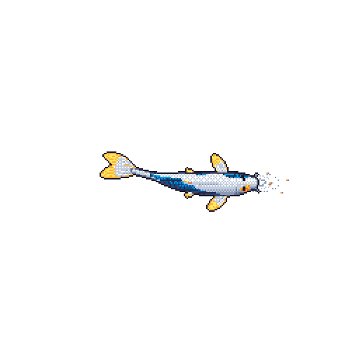

# aaljoudi

Building HyperShell — an AI-powered shell extension for real-time command suggestions and fixes.

**[aaljoudi.com](https://aaljoudi.com)** · [LinkedIn](https://www.linkedin.com/in/aaljoudi) · [Email](mailto:aaljoudi@umich.edu)

C / C++ · Python · JavaScript · Cloud · Machine learning

---

### On GitHub

  
   
  
   
  

### My koi

  
  
My GitHub activity, as a koi. Redrawn every day.

